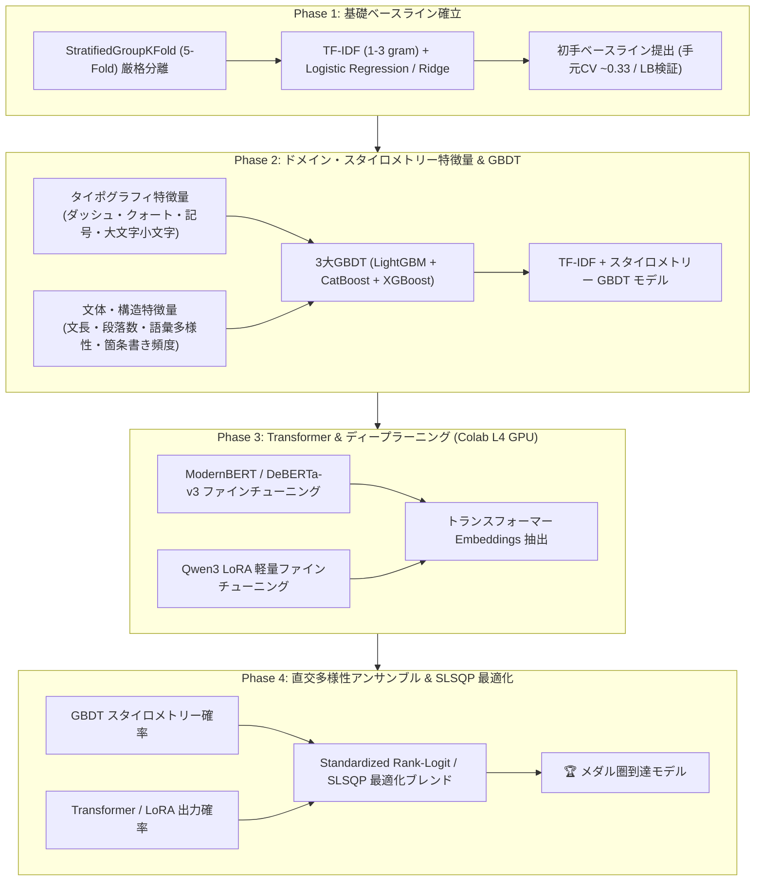

# [Featured] Name That LLM：生成LLM識別コンペティション

本ディレクトリ（`005_name-that-llm`）は、Kaggle Featured コンペティション **「Name That LLM」** における調査、検証設計、特徴量設計、モデリング、および実験ログを管理する作業環境です。

- **Kaggle コンペティション URL:** [Name That LLM](https://www.kaggle.com/competitions/name-that-llm)
- **追跡 GitHub Issue 正本:** [kumakit/mission-control#444](https://github.com/kumakit/mission-control/issues/444)
- **ルール・規約 URL (要同意):** [Competition Rules](https://www.kaggle.com/competitions/name-that-llm/rules)
- **賞金総額:** $50,000 USD
- **締切日:** 2027年1月14日 23:59:00 UTC
- **評価指標:** **Balanced Accuracy**
- **実験管理ログ正本:** [`learning-log.md`](file:///C:/Users/kumat/dev/kaggle/005_name-that-llm/learning-log.md)

---

## 1. コンペティション概要・ドメイン知識

### ① タスクの定義
与えられたテキストパッセージが、どの生成 LLM（全 18 種類：GPT-5.6 系、Gemini-3 系、Claude-4 系、Qwen-3 系、GLM-5.3、Kimi-k3 など）によって出力されたものかを予測する **18 クラス多クラス分類タスク**。

### ② データ構造と特性
- **`train.csv`:** 2,699 行
  - 各プロンプト（`prompt_id`）に対して、約 18 種類のモデルがそれぞれ 1 件ずつ回答を生成した構造。
- **交絡因子としてのトピック（Topic Confounder）:**
  - 同一プロンプトに対する回答同士（Siblings）は、話題（トピック・内容）が極めて近い。
  - ランダムな KFold 分割を行うと、同一プロンプトの他モデルの回答が訓練データに混入し、モデルがトピックに引きずられて誤答を学習する **「逆リーク（Reverse Leakage）」** が発生する。
- **コミュニティ外部データ（Open Pool）:**
  - 61 以上のソースから集約された数十万件のオープンデータプールが存在し、事前学習や追加学習に活用されている。

---

## 2. 検証戦略 (Validation Strategy)

### 鉄則: **`StratifiedGroupKFold(n_splits=5)` on `prompt_id`**
- 同一の `prompt_id` を訓練と検証に絶対に跨がせない（Group K-Fold）。
- 各 Fold で 18 クラスの比率を均等に保つ（Stratified）。
- これにより、ディスカッションで検証されている通り、手元 CV と Public LB が $r \approx 0.99$ で完全に連動する。

---

## 3. モデリング・実験ロードマップ



---

## 4. ディレクトリ構成

```text
005_name-that-llm/
├── README.md               # 本ドキュメント（コンペ概要・検証設計）
├── learning-log.md         # 全実験の記録（CV、LB、考察）
├── data/                   # train.csv, test.csv, sample_submission
├── notebooks/              # EDA・実験用 Jupyter Notebooks
└── src/                    # 再現スクリプト・モデリングコード
    ├── baseline.py         # 厳格Grouped-CV + TF-IDFベースライン
    ├── feature_engineering.py # タイポグラフィ・文体特徴量抽出
    └── exp0XX_colab_l4.py  # Colab L4 GPU 実行用スクリプト
```
